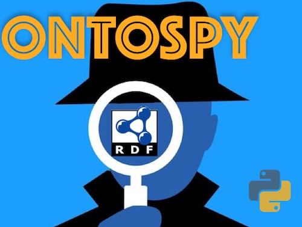
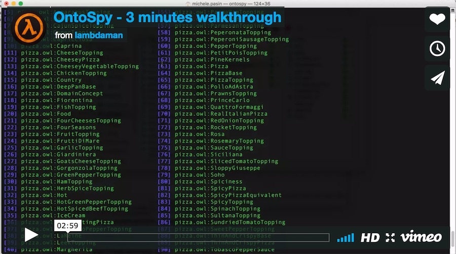

# Ontospy

Ontospy is a lightweight Python library and command line tool for working with vocabularies encoded in the [RDF](https://en.wikipedia.org/wiki/Resource_Description_Framework) family of languages: RDFS, OWL, SKOS and SHACL.

```bash
$ pip install ontospy
```

## In a nutshell

Ontospy can be used either as an interactive command line interface (a
[repl](https://en.wikipedia.org/wiki/Read%E2%80%93eval%E2%80%93print_loop)) or as a Python package.

Calling the `ontospy` command from a terminal window launches a utility for scanning a knowledge model encoded in RDF (or any of its dialects e.g. RDFS, OWL or SKOS).

For example, if you pass a valid graph URI:

```bash
$ ontospy scan http://purl.org/spar/frbr
```

Ontospy will extract and print out any ontology-related information contained in that graph.

Many other options are available, in particular Ontospy allows to load/save ontologies from/to a local repository so that they can be cached and quickly reloaded for inspection later on. All without leaving your terminal window!

[](https://youtu.be/MkKrtVHi_Ks)

Ontospy can also [generate documentation](gendocs.html) for an ontology, as HTML pages, Markdown files or interactive charts. Have a look at the [examples](https://lambdamusic.github.io/ontospy-examples/): 32 well-known ontologies, from FOAF and SKOS to PROV-O, GeoSPARQL and FIBO.

## Is Ontospy for me?

Here are some reasons why you should use it:

-   You are developing a Python application that needs to extract schema information from an RDF, SKOS or OWL vocabulary.
-   You have a bunch of RDF vocabularies you regularly need to interrogate, but do not want to load a full-blown ontology editor like Protege.
-   You need to quickly generate documentation for an ontology, either as simple html pages or via some more elaborate interactive visualization.
-   You love the command line and would never leave it no matter what.

> note: Ontospy does not offer any ontology-editing features

## Where to go next

-   [Installation](installation.html)
-   [Quick start](quick-start.html): load an ontology in Python and explore it
-   [Command line](command-line.html): the `ontospy` command and its subcommands
-   [Generating documentation](gendocs.html), and how to customise it
-   The [getting started notebook](https://github.com/lambdamusic/ontospy/blob/master/examples/getting-started.ipynb), for a longer walkthrough
-   What's new: the [changelog](pages/changelog.html)

Issues or questions? Head over to the [issues](https://github.com/lambdamusic/Ontospy/issues) page.
